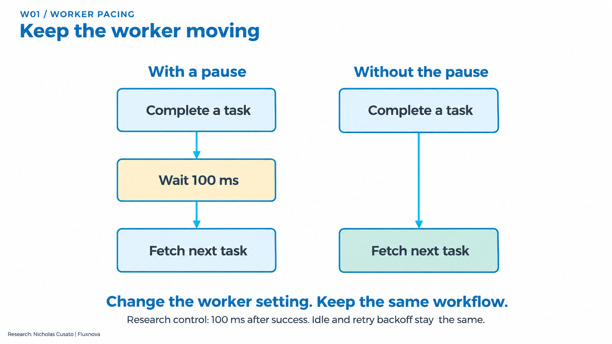
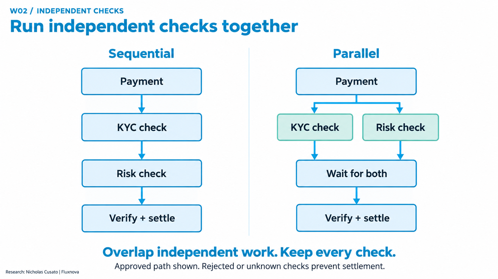
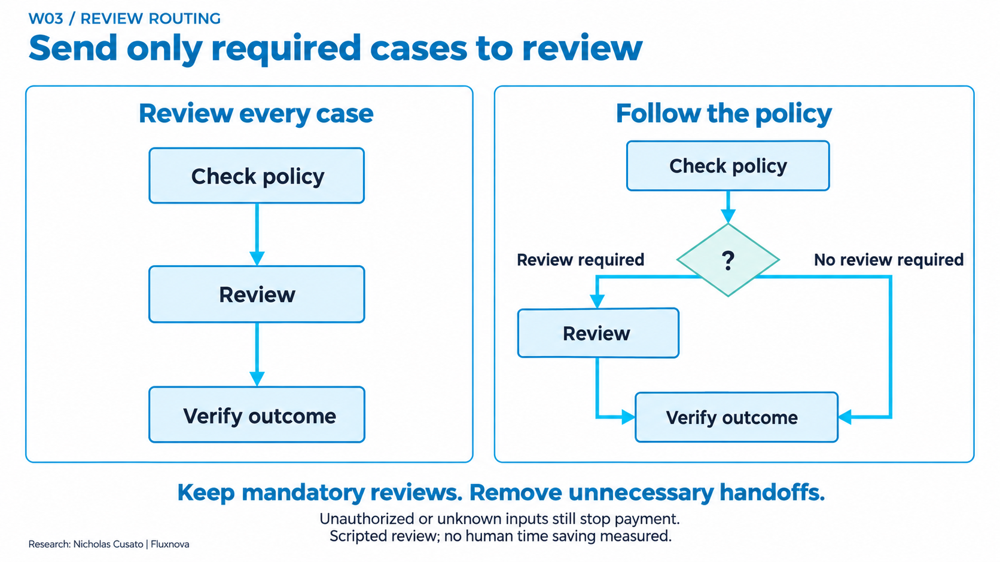
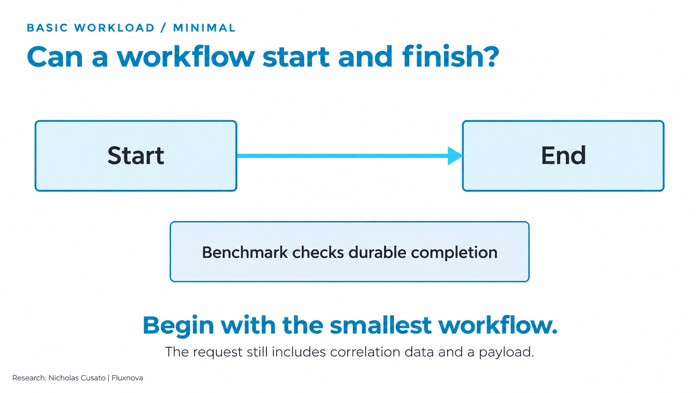
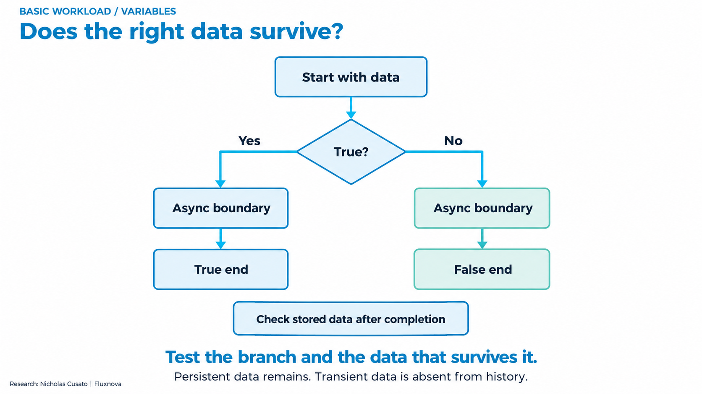
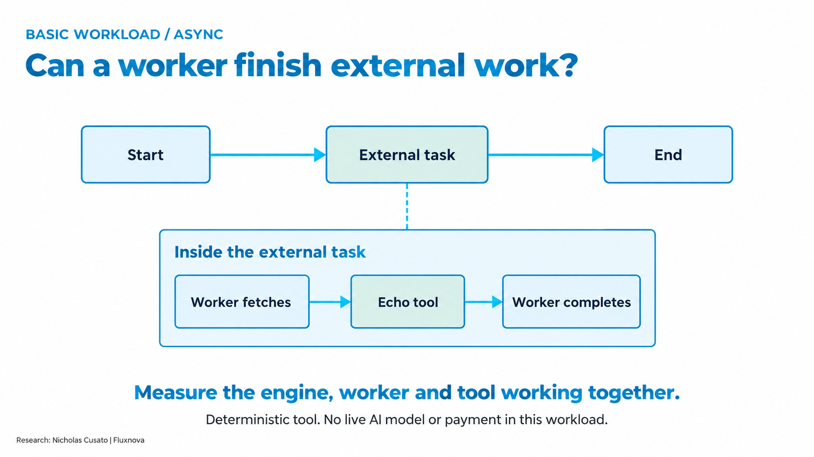
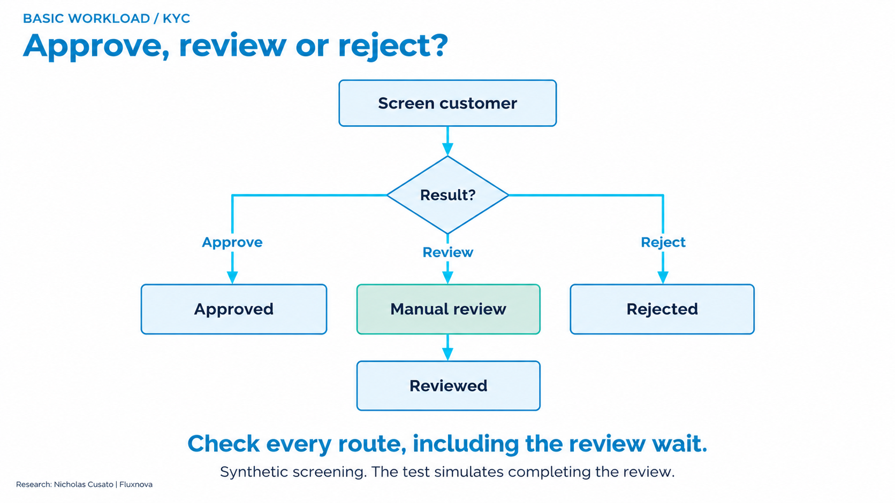
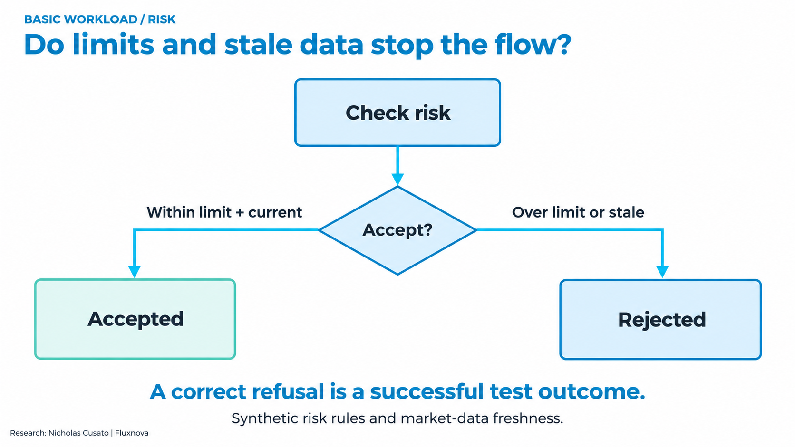
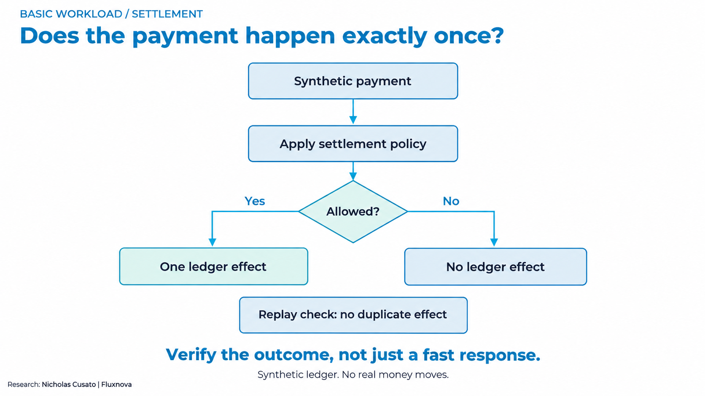

# Fluxnova workflow benchmarking

Measure how quickly and reliably financial and agentic workflows reach **correct, authorized outcomes**. This toolkit provides BPMN workloads, deterministic services, load generation, outcome checks and evidence-based reports for controlled Fluxnova comparisons.

[One-page research brief](docs/assets/fluxnova-research-brief-20261028.pdf) | [Get started](docs/getting-started.md) | [Results](docs/workload-completion.md) | [Benchmark protocol](docs/benchmark-protocol.md) | [Contribute](CONTRIBUTING.md)

Independent research and OCI implementation by **Nicholas Cusato**. Fluxnova is a FINOS project; this repository is a contribution candidate, not an adopted FINOS standard or an official Fluxnova release. See the [release policy](docs/public-release.md).

## Try it in two minutes

Use Git and Python 3.12 or newer. Run from the checkout root; the offline reporting demo needs no cloud account, credentials or extra Python packages.

```bash
git clone https://github.com/oci-fsi-pursuits/fluxnova-benchmark-kit.git
cd fluxnova-benchmark-kit
python -m benchlib.cli demo
```

Open the HTML path printed by the command. If your chat or terminal cannot open file links, use:

```bash
python scripts/open_report.py --path PATH_TO_REPORT.html
```

**The demo creates labeled sample data. It does not run Fluxnova or measure its performance.** The [getting-started guide](docs/getting-started.md) separates this demo, local functional testing and measured cloud studies.

## How a measured workflow works

Imagine you build a payment workflow and want to know whether a change helps. This kit runs repeatable cases through the actual engine and checks both the time taken and the outcome.

1. **Choose the flow and its inputs.** A BPMN file defines the order of tasks and decisions. Worker code performs the external work. Test cases declare the expected outcome before execution.
2. **Fix the conditions.** Record the software versions, machine resources, starting state, request rate and deadline. For a comparison, change one declared factor.
3. **Send repeatable requests.** The load runner starts workflows at the chosen rate or burst pattern. Each request has an identity so its events and results can be joined.
4. **Watch and verify.** Observe durable engine history, then check stored data and independent tool receipts. For payments, check the original policy and the exact synthetic ledger effect. A successful HTTP response alone is insufficient.
5. **Compare the evidence.** Report latency, correct outcomes, deadline misses, dropped starts and resource use. Repeat matched runs and retain failures as well as successes.

**The clock includes completion polling.** These are externally observed workflow times, not isolated engine processing times. Expected refusals and safe stops are checked separately from completed payments. Model-assisted and human-review paths have separate checks; live model calls and human waiting time are outside the deterministic load comparisons.

An **endurance run** holds one configuration and request rate steady for hours. It checks whether correctness, response times, queues, memory, storage and telemetry remain healthy as work accumulates. Its results need a final outcome audit and a review of resource growth before acceptance.

The separate [FNV-06 event and batch qualification](docs/fnv06-events-and-batches.md) checks who receives messages, signals and bulk changes. Twelve case families passed across 42 workflow instances both locally and in a separate [OCI/PostgreSQL qualification](validation/oci-20261101-fnv06/README.md), including a read-only SQL cross-check. Performance measurements remain open.

## Three changes you can see

### 1. Keep the worker moving

The payment workflow stays the same. We compare a reconstructed 100 ms pause after successful work with fetching the next task immediately. Empty-poll and retry backoff stay unchanged.



[W01 implementation and evidence](docs/w01-worker-pacing.md)

### 2. Run independent checks together

Both designs perform KYC and risk checks. The parallel design starts the independent checks together and waits for both before applying the same verification and settlement policy.



[W02 implementation and evidence](docs/w02-independent-checks.md). The mixed-outcome follow-up uses this same graph with more input cases and dependency delays.

### 3. Send only required cases to review

The control sends every case to a reviewer. Policy routing retains mandatory reviews and lets other cases reach verification directly. Rejected or unknown inputs still cannot cause a payment.



[W03 implementation and evidence](docs/w03-review-routing.md). Reviewers are scripted in this study; human time saved was not measured.

<details>
<summary><strong>Explore the six basic workload types</strong></summary>

These are implemented building blocks. The three comparisons above reuse or extend them. Six workload types plus three comparison diagrams make nine explanatory images, with different evidence scopes. Additional agent, approval and recovery tests are documented separately in the [workload guide](docs/workloads.md).

### Start and finish (`minimal`)

The smallest process checks durable completion and its recorded identity. Its input still includes correlation data and a payload.



### Preserve the right data (`variables`)

A Boolean chooses a branch. After the asynchronous boundary, persistent data must remain and transient data must be absent from history. The boundary boxes explain engine behavior; they are not additional service tasks.



### Finish external work (`async`)

The engine activates an external task. A worker fetches it, calls a deterministic echo tool and completes it. This is the workload used for the endurance study; it contains no live AI call or payment.



### Screen a customer (`kyc`)

Synthetic screening can approve, reject or create a real review task. The test explicitly simulates completing that task.



### Enforce risk rules (`risk`)

The test checks acceptance for permitted inputs and rejection for an excessive notional or stale market input.



### Check the payment effect (`settlement`)

The synthetic backend enforces policy before creating a ledger effect. Independent checks cover the exact effect, replay deduplication and recovery after a lost response. No real money moves.



</details>

The diagrams explain the flows; the executable BPMN, worker code and case definitions are the technical source of truth. See [workload contracts](docs/workloads.md) and [reproduction steps](docs/reproduce.md) to run or adapt them. Research and diagram content: **Nicholas Cusato**; Fluxnova software: **FINOS contributors**. [Image provenance and branding](docs/assets/README.md).

## What has been measured

| Study | Controlled comparison | Audited finding | Scope |
| --- | --- | --- | --- |
| [W01 worker pacing](validation/oci-20261027-w01-comparison/README.md) | Reconstructed 100 ms success delay versus idle-only backoff | Timely payments rose from 600/1,200 to 1,200/1,200; all 2,400 correct | Five matched OCI burst pairs |
| [W02 independent checks](validation/oci-20261027-w02-comparison/README.md) | Sequential versus parallel KYC/risk, with two worker slots in both | Median paired observed p95 reduced 32.1%; 6,000/6,000 correct and within two seconds | Five matched OCI pairs at 1 start/s; deadline goodput unchanged |
| [W03 review routing](validation/local-20261027-w03/README.md) | Review every case versus fixed-policy routing | Review tasks 10 to 4, preserving all four mandatory reviews and 20/20 outcomes | Local synthetic cases with scripted review |
| [PAY-05 FX quotes](validation/oci-20261031-pay05-comparison/README.md) | Sequential versus parallel quote requests, with three worker slots in both | Timely settlements 668/1,530 to 1,530/1,530; all 3,960 measured outcomes correct | Five matched OCI pairs at 0.5 starts/s; three synthetic delay profiles |

The [mixed-outcome follow-up](validation/oci-20261028-w02-mixed-comparison/README.md) also completed all five pairs: 6,000 correct outcomes across five dependency profiles. Parallel checks increased timely settlements from **880 to 1,037 of 1,200**, while timely refusals fell from **780 to 669 of 1,200**. The median paired settlement change was **+0.0517/s**. All 1,648 deadline misses are retained. See the [pattern register](docs/workload-completion.md) for the tradeoff and complete scope.

PAY-05 also recorded 910 cached backend replays during measured parallel work, versus zero sequentially, without duplicate effects. Its [evidence](validation/oci-20261031-pay05-comparison/summary.json) reports the additional attempts alongside timeliness. Each study keeps its own population and controls.

For the actual saved W02 mixed result, run `python scripts/open_report.py --path docs/results/w02-mixed/report.html` after cloning. This report requires no cloud account and submits no payments.

These results describe their declared synthetic workloads and environments. They do not establish maximum capacity, customer traffic performance, human time savings, live-agent value or OCI superiority. Complete allocated cost per outcome remains open.

## Choose your path

| Goal | Entry point | What you need |
| --- | --- | --- |
| Understand the research | [One-page PDF](docs/assets/fluxnova-research-brief-20261028.pdf), [brief](docs/research-brief.md) | A PDF reader or browser |
| Explore report behavior | `python -m benchlib.cli demo` | Python 3.12+ |
| Build and test a local workflow | [Reproduction guide](docs/reproduce.md) | A Linux container host, pinned artifacts and declared test inputs |
| Run a measured OCI study | [OCI setup](docs/oci.md), [campaign runbook](docs/campaign-runbook.md) | Your own isolated resources, identities, secrets, telemetry, cost coverage and cleanup |
| Bring the workload elsewhere | [Portability](docs/portability.md) | Replacement provisioning and integrations, followed by validation |
| Add a comparison | [Contribution guide](CONTRIBUTING.md), [protocol](docs/benchmark-protocol.md) | An original-input oracle, negative cases and a reproducible test |

The portable core is Python, BPMN, k6, containers and evidence contracts. Automated cloud provisioning currently targets OCI Compute and PostgreSQL. There is no turnkey AWS, Azure or on-premises provisioning switch, and the isolated W01/W02 operator workflow requires environment-specific preparation. See the [support matrix](docs/portability.md).

## Measurement principles

- Declare the baseline, treatment, population, deadline and resource limits before running.
- Change one factor; match starting state and use repeated paired measurements.
- Verify original intent, expected decisions and exact business effects independently of HTTP success.
- Report settlements, expected refusals and safe stops separately. Refusals do not count as payment throughput.
- Retain failed runs, drops, unresolved outcomes and deadline misses. Keep model and human-review time separate.
- Preserve artifact hashes, raw events, controls, reset evidence and telemetry for independent audit.

The [measurement contract](docs/measurement-contract.md) defines the metrics. The [proposed protocol](docs/benchmark-protocol.md) defines a community submission.

## Develop and contribute

```bash
python -m unittest discover -s tests -v
python -m benchlib.cli --help
```

[CI](https://github.com/oci-fsi-pursuits/fluxnova-benchmark-kit/actions/workflows/ci.yml) checks Linux/Python 3.12 and Windows/Python 3.13, the offline demo, history and clean-snapshot secret scans, and deployable review-form resources. Optional k6 checks skip when `BENCH_TEST_K6_BINARY` is absent; CI installs a checksum-verified binary. Release validation requires no skipped k6 checks.

Use [CONTRIBUTING.md](CONTRIBUTING.md), [SECURITY.md](SECURITY.md) and [CITATION.cff](CITATION.cff). The [upstream proposal](docs/upstream-proposal.md) separates the portable harness from OCI integration. FINOS acceptance requires maintainer review and its contributor requirements.

The code uses [Apache 2.0](LICENSE). The [release policy](docs/public-release.md) requires matching test and sanitization receipts for the published commit. The clean companion includes only the [explicit final-document inventory](release/public-files.json); earlier presentations and internal research history stay private.
