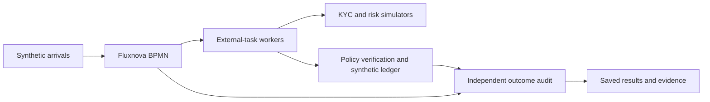

# Fluxnova workflow benchmarking

Measure how quickly and reliably financial and agentic workflows reach **correct, authorized outcomes**. This toolkit provides BPMN workloads, deterministic services, load generation, outcome checks and evidence-based reports for controlled Fluxnova comparisons.

[One-page research brief](docs/assets/fluxnova-research-brief-20261028.pdf) | [Get started](docs/getting-started.md) | [Results](docs/workload-completion.md) | [Benchmark protocol](docs/benchmark-protocol.md) | [Contribute](CONTRIBUTING.md)

Independent research and OCI implementation by **Nicholas Cusato**. Fluxnova is a FINOS project; this repository is a contribution candidate, not an adopted FINOS standard or an official Fluxnova release. See the [release policy](docs/public-release.md).

## Try it in two minutes

Use Git and Python 3.12 or newer. Run from the checkout root; the offline reporting demo needs no cloud account, credentials or extra Python packages.

```bash
git clone https://github.com/oci-fsi-pursuits/fluxnova-benchmark-kit.git
cd fluxnova-benchmark-kit
python -m benchlib.cli demo
```

Open the HTML path printed by the command. If your chat or terminal cannot open file links, use:

```bash
python scripts/open_report.py --path PATH_TO_REPORT.html
```

**The demo creates labeled sample data. It does not run Fluxnova or measure its performance.** The [getting-started guide](docs/getting-started.md) separates this demo, local functional testing and measured cloud studies.

## How a measured workflow works



The workload declares the expected decision and exact payment effect before execution. The audit checks engine history and the original case records. Model-assisted and human-review paths have separate functional checks; live model calls and human waiting time are outside the deterministic load comparisons.

## What has been measured

| Study | Controlled comparison | Audited finding | Scope |
| --- | --- | --- | --- |
| [W01 worker pacing](validation/oci-20261027-w01-comparison/README.md) | Reconstructed 100 ms success delay versus idle-only backoff | Timely payments rose from 600/1,200 to 1,200/1,200; all 2,400 correct | Five matched OCI burst pairs |
| [W02 independent checks](validation/oci-20261027-w02-comparison/README.md) | Sequential versus parallel KYC/risk, with two worker slots in both | Median paired observed p95 reduced 32.1%; 6,000/6,000 correct and within two seconds | Five matched OCI pairs at 1 start/s; deadline goodput unchanged |
| [W03 review routing](validation/local-20261027-w03/README.md) | Review every case versus fixed-policy routing | Review tasks 10 to 4, preserving all four mandatory reviews and 20/20 outcomes | Local synthetic cases with scripted review |

The [mixed-outcome follow-up](validation/oci-20261028-w02-mixed-comparison/README.md) also completed all five pairs: 6,000 correct outcomes across five dependency profiles. Parallel checks increased timely settlements from **880 to 1,037 of 1,200**, while timely refusals fell from **780 to 669 of 1,200**. The median paired settlement change was **+0.0517/s**. All 1,648 deadline misses are retained. See the [pattern register](docs/workload-completion.md) for the tradeoff and complete scope.

For the actual saved result, run `python scripts/open_report.py --path docs/results/w02-mixed/report.html` after cloning. This report requires no cloud account and submits no payments.

These results describe their declared synthetic workloads and environments. They do not establish maximum capacity, customer traffic performance, human time savings, live-agent value or OCI superiority. Complete allocated cost per outcome remains open.

## Choose your path

| Goal | Entry point | What you need |
| --- | --- | --- |
| Understand the research | [One-page PDF](docs/assets/fluxnova-research-brief-20261028.pdf), [brief](docs/research-brief.md) | A PDF reader or browser |
| Explore report behavior | `python -m benchlib.cli demo` | Python 3.12+ |
| Build and test a local workflow | [Reproduction guide](docs/reproduce.md) | A Linux container host, pinned artifacts and declared test inputs |
| Run a measured OCI study | [OCI setup](docs/oci.md), [campaign runbook](docs/campaign-runbook.md) | Your own isolated resources, identities, secrets, telemetry, cost coverage and cleanup |
| Bring the workload elsewhere | [Portability](docs/portability.md) | Replacement provisioning and integrations, followed by validation |
| Add a comparison | [Contribution guide](CONTRIBUTING.md), [protocol](docs/benchmark-protocol.md) | An original-input oracle, negative cases and a reproducible test |

The portable core is Python, BPMN, k6, containers and evidence contracts. Automated cloud provisioning currently targets OCI Compute and PostgreSQL. There is no turnkey AWS, Azure or on-premises provisioning switch, and the isolated W01/W02 operator workflow requires environment-specific preparation. See the [support matrix](docs/portability.md).

## Measurement principles

- Declare the baseline, treatment, population, deadline and resource limits before running.
- Change one factor; match starting state and use repeated paired measurements.
- Verify original intent, expected decisions and exact business effects independently of HTTP success.
- Report settlements, expected refusals and safe stops separately. Refusals do not count as payment throughput.
- Retain failed runs, drops, unresolved outcomes and deadline misses. Keep model and human-review time separate.
- Preserve artifact hashes, raw events, controls, reset evidence and telemetry for independent audit.

The [measurement contract](docs/measurement-contract.md) defines the metrics. The [proposed protocol](docs/benchmark-protocol.md) defines a community submission.

## Develop and contribute

```bash
python -m unittest discover -s tests -v
python -m benchlib.cli --help
```

[CI](https://github.com/oci-fsi-pursuits/fluxnova-benchmark-kit/actions/workflows/ci.yml) checks Linux/Python 3.12 and Windows/Python 3.13, the offline demo, history and clean-snapshot secret scans, and deployable review-form resources. Optional k6 checks skip when `BENCH_TEST_K6_BINARY` is absent; CI installs a checksum-verified binary. Release validation requires no skipped k6 checks.

Use [CONTRIBUTING.md](CONTRIBUTING.md), [SECURITY.md](SECURITY.md) and [CITATION.cff](CITATION.cff). The [upstream proposal](docs/upstream-proposal.md) separates the portable harness from OCI integration. FINOS acceptance requires maintainer review and its contributor requirements.

The code uses [Apache 2.0](LICENSE). The [release policy](docs/public-release.md) requires matching test and sanitization receipts for the published commit. The clean companion includes only the [explicit final-document inventory](release/public-files.json); earlier presentations and internal research history stay private.
