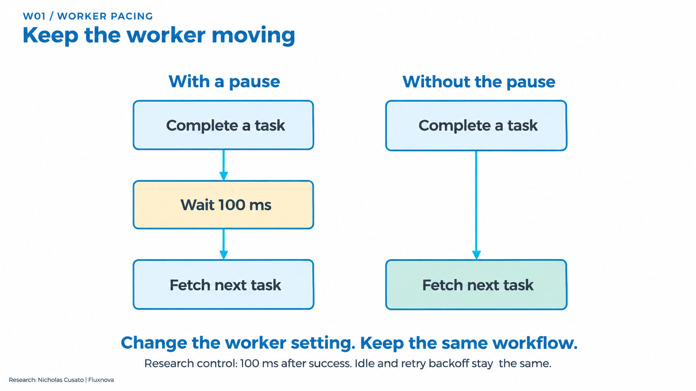
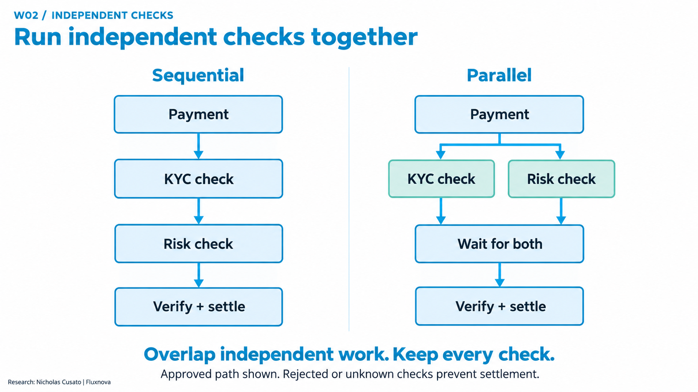
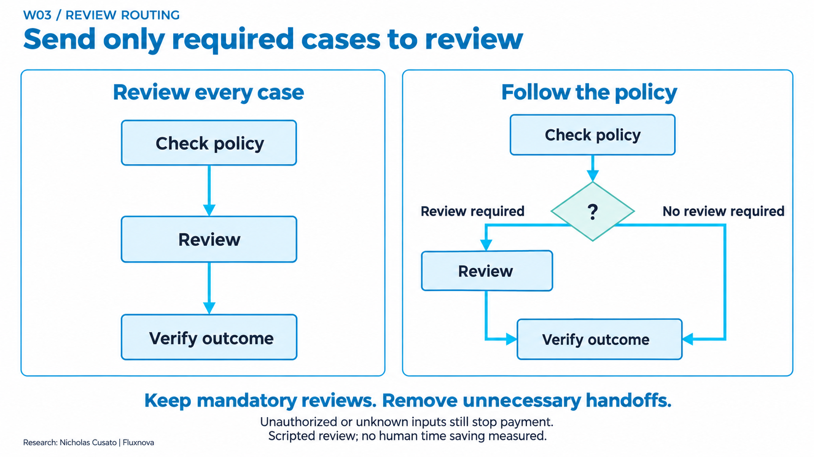
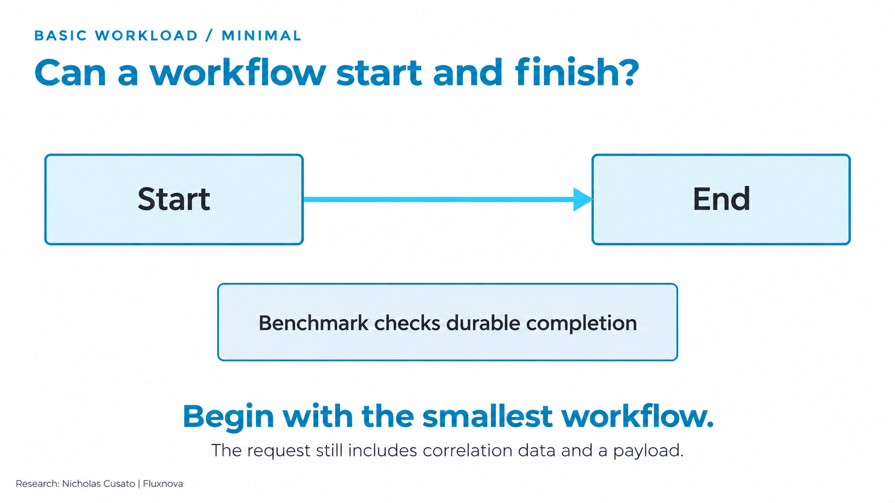
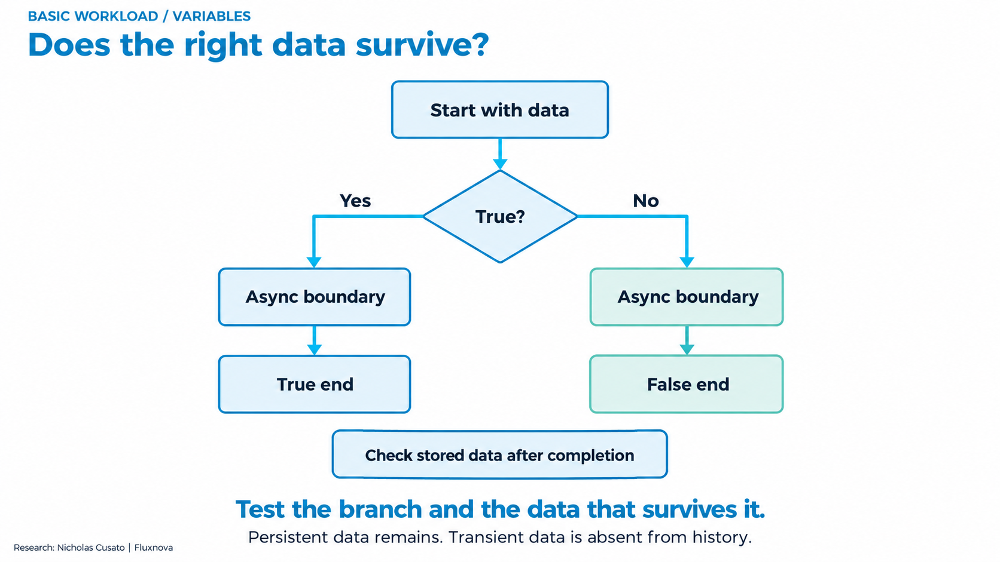
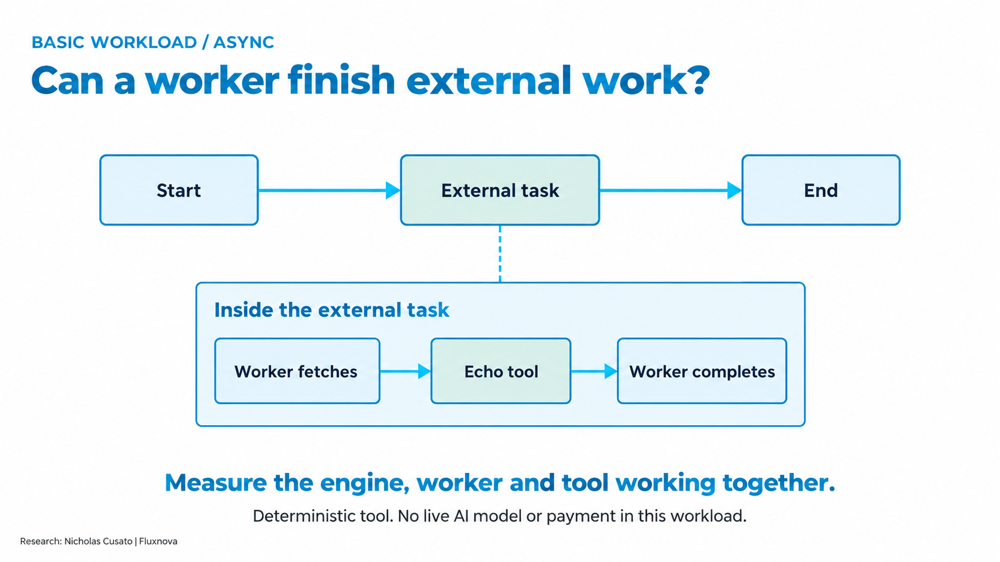
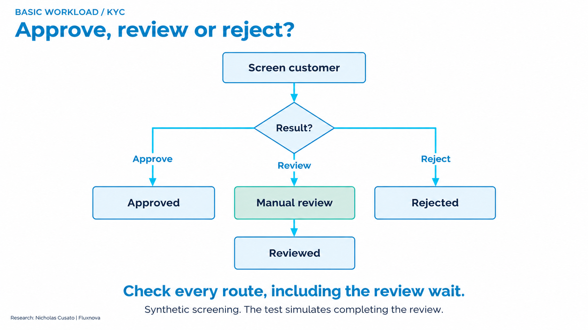
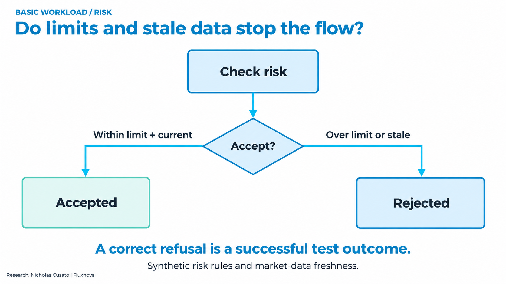
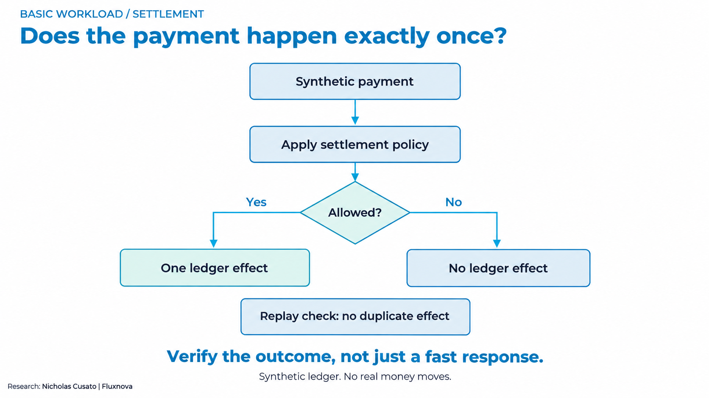

# What the Fluxnova benchmarks measure

Measure how workflow and runtime changes affect time to a correct, authorized outcome.

This guide is generated from the [versioned catalogue](../workloads/benchmark-catalog.json). Research and OCI implementation: **Nicholas Cusato**. Fluxnova software: **FINOS contributors**.

## The simplest explanation

A workflow developer chooses a reusable BPMN pattern and test inputs. The harness starts workflows, workers perform the declared tasks, and an independent checker compares the result with the original input. A comparison repeats the same experiment with one declared change. The business check matters: a quick response that pays the wrong amount is a failed test.

**A pattern is what runs. A benchmark type is how we test it. A study is one frozen experiment.** “Agentic” describes a workload that uses an agent; it does not by itself mean we measured AI quality or benefit.

## Types of benchmarking

| Type | Question it answers |
| --- | --- |
| Correctness and control checks | Does each input reach the right outcome, including rejection, review and replay? |
| Repeated latency comparison | Does one change reduce observed completion time at the same offered load? |
| Repeated deadline comparison | How much correct work finishes before the declared deadline? |
| Repeated baseline | How repeatable is this declared workload before changing a factor? |
| Endurance / soak | Does the declared load remain correct over an extended observation? |
| Load and capacity qualification | Which tested offered rates satisfy the full acceptance contract? |
| Finite-population scaling | How does completion time change when a burst targets more waiting workflows? |
| Fault and recovery checks | What happens to state and business effects during a specific injected failure? |
| Measurement diagnostics | How do observation and instrumentation settings affect what the harness reports? |

## How to read the results

- Every comparison has its own baseline. Different workloads, hosts or databases cannot be combined into one speedup.
- Correctness and speed answer different questions. A correctly refused payment can pass the test but does not count as a settlement.
- Observed p95 is the latency below which 95% of observed completions fall. It includes the declared observer boundary; it is not the slowest request or a pure engine timer.
- Deadline goodput counts correct outcomes within the deadline per second. Offered load counts starts requested per second. Neither alone establishes maximum capacity.
- Paired changes compare matched runs. A median of five changes is not a pooled percentile, and a range is not a confidence interval.
- Keep every miss, retry, interruption and invalid observation. Partial or resource-constrained results cannot be promoted to a completed capacity claim.
- Synthetic workflows expose controlled mechanisms. Customer traffic, live models, human time and complete cost per correct outcome require separate studies.

## Study register

| Study | Type and evidence level | Result |
| --- | --- | --- |
| [CORE: Six basic workflow patterns](#core) | Correctness and control checks; functional | Reusable workflows and golden checks define the basic test vocabulary. |
| [P01: Async reference baseline](#p01) | Repeated baseline; measured | 90,000/90,000 correct and within two seconds; per-run p95 245.7–249.0 ms. |
| [W01: Worker pacing under bursts](#w01) | Repeated deadline comparison; measured | Timely payments rose from 600/1,200 to 1,200/1,200. All 2,400 outcomes were correct. |
| [W02: Independent payment checks](#w02) | Repeated latency comparison; measured | Observed p95 was 32.1% lower at the median paired change. All 6,000 outcomes were correct and within two seconds. |
| [W02-MIXED: Different outcomes and dependency delays](#w02-mixed) | Repeated deadline comparison; measured | Timely settlements rose from 880 to 1,037 of 1,200; timely refusals fell from 780 to 669 of 1,200. All 6,000 outcomes were correct; 1,648 deadlines were missed. |
| [W03: Policy-based review routing](#w03) | Correctness and control checks; functional | Review tasks fell from 10 to 4. All four mandatory reviews remained and all 20 expected outcomes passed. |
| [PAY05: Parallel FX quote requests](#pay05) | Repeated deadline comparison; measured | Timely settlements rose from 668/1,530 to 1,530/1,530. All 3,960 outcomes were correct. Parallel runs retained 910 cached backend replays and zero duplicate payment effects. |
| [JVM: Java 21 versus Java 25](#jvm) | Repeated latency comparison; measured | Median paired p95 difference: −0.862 ms, range −1.369 to +0.864 ms. All 180,000 outcomes were correct and within two seconds. |
| [RELEASE: Fluxnova 3.0.1 versus 3.1.1](#release) | Repeated latency comparison; measured | Median paired p95 difference: +0.126 ms, range −0.552 to +1.055 ms. All 180,000 outcomes were correct and within two seconds. |
| [SOAK: Eight-hour async endurance](#soak) | Endurance / soak; measured | All 288,000 measured workflows completed correctly within two seconds. |
| [CAPACITY: Higher-rate confirmation](#capacity) | Load and capacity qualification; partial | The 16/s confirmation is incomplete. 16/s is not qualified. |
| [FNV06: Messages, signals and asynchronous batches](#fnv06) | Finite-population scaling; partial | All 16,650 measured recipients were correct. 43/45 cells passed the headroom gate; batch/1,000 timing comparisons remain unqualified. |
| [FNV07: Cluster job faults and replay handling](#fnv07) | Fault and recovery checks; functional | Each six-case run produced the expected three completed, two blocked and one waiting outcomes, with 12 exact effects. |
| [FNV07-TIMING: Native job timing qualification](#fnv07-timing) | Correctness and control checks; functional | 20/20 workflows correct, 60 successful attempts and 60 exact effects. |
| [AGENT: Agent, reviewer and payment authority](#agent) | Correctness and control checks; partial | Functional checks exercise the control boundaries. A measured agent-versus-rules benefit remains unestablished. |
| [RECOVERY: State and dependency recovery](#recovery) | Fault and recovery checks; functional | Evidence covers specific recovery procedures and retained interruptions. |
| [OBSERVER: Polling and worker instrumentation](#observer) | Measurement diagnostics; diagnostic | Polling and timing settings belong in the experiment contract. |

## CORE

**Six basic workflow patterns**. Can the engine start, persist data, coordinate external work, route decisions and protect a synthetic payment?

**Evidence:** Reusable functional building blocks. Correctness and control checks; functional.

**Control and change:** Declared input and independently expected outcome → No performance treatment in this record

**Held fixed:** The BPMN, payload and expected-outcome rules for each case.

**Test:** Minimal, variables, async, KYC, risk and settlement cases. not applicable Local Java/H2 lab or separately qualified OCI deployment.

**Metric and clock:** Correct branch, durable values and exact expected effects. Functional completion and state checks; no aggregate speedup.

**Result:** Reusable workflows and golden checks define the basic test vocabulary.

**What it means:** These are small building blocks a workflow developer can combine and extend.

**Boundary:** A diagram alone is not a completed performance study. The six basic patterns do not each have a repeated latency comparison.

[Reproduction route](reproduce.md). [Evidence 1](../validation/research-register-20261101/summary.json)

## P01

**Async reference baseline**. Is the external-task/echo path repeatable at the declared load?

**Evidence:** Completed. Repeated baseline; measured.

**Control and change:** Fluxnova 3.0.1, async external-task/echo → Repeat the same configuration

**Held fixed:** Synthetic inputs, policy, worker count, resources, database and completion observer within each pair.

**Test:** 10 starts/s; 10-minute warmup then 30-minute measurement. Five measurements. Four-host OCI reference and PostgreSQL.

**Metric and clock:** Observed p95, correctness and correct completions within two seconds. Scheduled arrival to durable-history completion observation. Completion polling is part of this measurement. Polling: 100 ms.

**Result:** 90,000/90,000 correct and within two seconds; per-run p95 245.7–249.0 ms.

**What it means:** This establishes a repeatable reference for this workflow and setup.

**Boundary:** The echo workload contains no payment or live model. This is not maximum capacity or an engine-only microbenchmark.

[Reproduction route](campaign-runbook.md). [Evidence 1](../validation/research-register-20261101/summary.json)

## W01

**Worker pacing under bursts**. Does an unnecessary pause after successful work delay later payments?

**Evidence:** Completed. Repeated deadline comparison; measured.

**Control and change:** Reconstructed 100 ms delay after success → Fetch immediately after success; keep idle/retry backoff

**Held fixed:** Synthetic inputs, policy, worker count, resources, database and completion observer within each pair.

**Test:** 20 arrivals in a one-second burst every ten seconds; mean 2/s. 120-second warmup and 120-second measurement per arm. Five matched pairs. Shared OCI controller compute with separate PostgreSQL; one worker.

**Metric and clock:** Correct payments within two seconds; median paired timely-goodput change. Scheduled arrival to durable-history completion observation. Completion polling is part of this measurement.

**Result:** Timely payments rose from 600/1,200 to 1,200/1,200. All 2,400 outcomes were correct.

**What it means:** Avoidable worker waiting can consume the deadline even when the payment logic is unchanged.

**Boundary:** The control reconstructs an earlier worker setting. It is not the current default or a customer production baseline.

[Reproduction route](w01-worker-pacing.md). [Evidence 1](../validation/oci-20261027-w01-comparison/summary.json)

## W02

**Independent payment checks**. Can independent KYC and risk checks overlap without weakening payment checks?

**Evidence:** Completed. Repeated latency comparison; measured.

**Control and change:** Sequential KYC then risk → Parallel KYC and risk, with a join before settlement

**Held fixed:** Synthetic inputs, policy, worker count, resources, database and completion observer within each pair.

**Test:** Approved synthetic payments at 1/s. KYC waits 400 ms; risk waits 600 ms. 2-minute warmup and 10-minute measurement per arm. Five matched pairs. Shared OCI controller and separate PostgreSQL; two worker slots.

**Metric and clock:** Median of paired percentage changes in observed completion p95. Scheduled arrival to durable-history completion observation. Completion polling is part of this measurement. Polling: 100 ms.

**Result:** Observed p95 was 32.1% lower at the median paired change. All 6,000 outcomes were correct and within two seconds.

**What it means:** Overlap independent waits while preserving the requirement that both checks finish.

**Boundary:** Both arms still delivered 1 timely payment/s. This establishes lower latency at this load, not higher maximum capacity or real-provider latency.

[Reproduction route](w02-independent-checks.md). [Evidence 1](../validation/oci-20261027-w02-comparison/summary.json)

## W02-MIXED

**Different outcomes and dependency delays**. Does the parallel-check result hold across settlements, refusals and safe stops?

**Evidence:** Completed with deadline misses retained. Repeated deadline comparison; measured.

**Control and change:** Sequential independent checks → Parallel independent checks

**Held fixed:** Synthetic inputs, policy, worker count, resources, database and completion observer within each pair.

**Test:** Five dependency profiles and mixed expected outcomes at 1/s; 600 measured arrivals per arm. Five matched pairs. Matched OCI controller/PostgreSQL setup.

**Metric and clock:** Timely correct settlements/s, with refusals and safe stops reported separately. Scheduled arrival to durable-history completion observation. Completion polling is part of this measurement. Polling: 100 ms.

**Result:** Timely settlements rose from 880 to 1,037 of 1,200; timely refusals fell from 780 to 669 of 1,200. All 6,000 outcomes were correct; 1,648 deadlines were missed.

**What it means:** A change can help one outcome class and hurt another. Keep the outcome breakdown.

**Boundary:** Equal synthetic coverage is not a customer traffic distribution. The approved-only 32.1% result cannot be applied to this mix.

[Reproduction route](w02-mixed-cloud-protocol.md). [Evidence 1](../validation/oci-20261028-w02-mixed-comparison/summary.json)

## W03

**Policy-based review routing**. Can a fixed policy remove unnecessary review tasks while retaining required reviews?

**Evidence:** Completed within the scripted corpus. Correctness and control checks; functional.

**Control and change:** Review every case → Route only policy-required cases to review

**Held fixed:** Same ten inputs, decision policy, authenticated reviewer checks and final outcome verifier.

**Test:** Ten synthetic cases in each arm. One execution of each case per arm; replay probes separately retained. Local Fluxnova 3.0.1 / Java 21 / H2.

**Metric and clock:** Review-task count and correct expected outcomes. Scripted reviews; human waiting or working time is not measured.

**Result:** Review tasks fell from 10 to 4. All four mandatory reviews remained and all 20 expected outcomes passed.

**What it means:** This workflow removes avoidable handoffs for the declared policy and case mix.

**Boundary:** This is a task-count comparison, not measured human time or a 60% staffing saving. The all-review control is deliberately constrained.

[Reproduction route](w03-review-routing.md). [Evidence 1](../validation/local-20261027-w03/summary.json)

## PAY05

**Parallel FX quote requests**. Can parallel requests to three independent quote providers improve timely settlement?

**Evidence:** Completed with retry tradeoff retained. Repeated deadline comparison; measured.

**Control and change:** Request three synthetic quotes sequentially → Request the same quotes in parallel before selection

**Held fixed:** Synthetic inputs, policy, worker count, resources, database and completion observer within each pair. Three worker slots in both arms.

**Test:** 22 cases × three delay profiles; 396 measured arrivals per arm at 0.5/s. 132-second warmup, 792-second measurement and 30-second drain. Five matched pairs. Shared OCI controller and separate PostgreSQL 17.6.

**Metric and clock:** Median paired change in correct settlements within two seconds per second. Scheduled arrival to durable-history completion observation. Completion polling is part of this measurement. Polling: 100 ms.

**Result:** Timely settlements rose from 668/1,530 to 1,530/1,530. All 3,960 outcomes were correct. Parallel runs retained 910 cached backend replays and zero duplicate payment effects.

**What it means:** Overlapping quote waits helps delayed-provider cases. Durable replay handling protects the payment when completion retries occur.

**Boundary:** Sequential runs had zero cached replays. The parallel improvement has a retry tradeoff. Synthetic providers and equal case coverage do not represent a live FX venue or customer distribution.

[Reproduction route](pay05-fx-quotes.md). [Evidence 1](../validation/oci-20261031-pay05-comparison/summary.json)

## JVM

**Java 21 versus Java 25**. Does the newer Java runtime improve this fixed async workflow?

**Evidence:** Completed; earlier stopped study remains separate. Repeated latency comparison; measured.

**Control and change:** Java 21 → Java 25

**Held fixed:** Synthetic inputs, policy, worker count, resources, database and completion observer within each pair. Fluxnova 3.0.1 fixed.

**Test:** 10 starts/s; 10-minute warmup and 30-minute measurement per observation. Five matched pairs. Same fixed OCI reference and PostgreSQL.

**Metric and clock:** Median within-pair observed-p95 difference, Java 25 minus Java 21. Scheduled arrival to durable-history completion observation. Completion polling is part of this measurement. Polling: 100 ms before deadline, 1,000 ms afterward.

**Result:** Median paired p95 difference: −0.862 ms, range −1.369 to +0.864 ms. All 180,000 outcomes were correct and within two seconds.

**What it means:** The small differences changed sign. This workload did not establish a broad Java 25 performance advantage.

**Boundary:** Five pairs do not prove equivalence, maximum capacity or performance for other workflows. Earlier interrupted observations are not pooled.

[Reproduction route](benchmark-standard.md). [Evidence 1](../validation/research-register-20261101/summary.json)

## RELEASE

**Fluxnova 3.0.1 versus 3.1.1**. Does the engine release change this async workflow at the same load?

**Evidence:** Completed; earlier stopped study remains separate. Repeated latency comparison; measured.

**Control and change:** Fluxnova 3.0.1 → Fluxnova 3.1.1 with its required PostgreSQL migration

**Held fixed:** Synthetic inputs, policy, worker count, resources, database and completion observer within each pair. Java 21 fixed.

**Test:** 10 starts/s; 10-minute warmup and 30-minute measurement per observation. Five matched pairs. Same fixed OCI reference; release-specific native schemas.

**Metric and clock:** Median within-pair observed-p95 difference, 3.1.1 minus 3.0.1. Scheduled arrival to durable-history completion observation. Completion polling is part of this measurement. Polling: 100 ms.

**Result:** Median paired p95 difference: +0.126 ms, range −0.552 to +1.055 ms. All 180,000 outcomes were correct and within two seconds.

**What it means:** Both releases met this test target. No meaningful speedup or capacity gain was established.

**Boundary:** This does not prove statistical equivalence, universal compatibility or production sizing. Native schema changes are part of the declared treatment.

[Reproduction route](benchmark-standard.md). [Evidence 1](../validation/research-register-20261101/summary.json)

## SOAK

**Eight-hour async endurance**. Does this workload stay correct through an eight-hour observation?

**Evidence:** Completed and accepted. Endurance / soak; measured.

**Control and change:** Fixed async reference → Extend the observation to eight hours

**Held fixed:** Synthetic inputs, policy, worker count, resources, database and completion observer within each pair.

**Test:** 10 starts/s for 28,800 measured seconds. One eight-hour observation. OCI reference with retained telemetry.

**Metric and clock:** Correctness, deadline outcomes and descriptive time windows. Scheduled arrival to durable-history completion observation. Completion polling is part of this measurement.

**Result:** All 288,000 measured workflows completed correctly within two seconds.

**What it means:** The reference sustained its declared target during this observation.

**Boundary:** One observation does not establish leak-free operation, maximum capacity or a production availability guarantee.

[Reproduction route](campaign-runbook.md). [Evidence 1](../validation/research-register-20261101/summary.json)

## CAPACITY

**Higher-rate confirmation**. Does the next offered rate satisfy the complete confirmation series?

**Evidence:** 16/s confirmation stopped. Load and capacity qualification; partial.

**Control and change:** Previously qualified reference rate → Higher offered rates with unchanged acceptance rules

**Held fixed:** Synthetic inputs, policy, worker count, resources, database and completion observer within each pair.

**Test:** 16 starts/s confirmation series. Five planned observations: three measured passes, one warmup interruption, one unattempted. OCI reference.

**Metric and clock:** Full-series correctness, deadlines, resources and retained interruptions. Scheduled arrival to durable-history completion observation. Completion polling is part of this measurement.

**Result:** The 16/s confirmation is incomplete. 16/s is not qualified.

**What it means:** Three passing observations cannot stand in for a complete five-observation confirmation.

**Boundary:** Maximum sustainable capacity remains open. Do not label a discovery rate or partial confirmation as production capacity.

[Reproduction route](campaign-runbook.md). [Evidence 1](../validation/research-register-20261101/summary.json)

## FNV06

**Messages, signals and asynchronous batches**. How does completion grow when the same pattern targets more waiting workflows?

**Evidence:** 45 cells complete; two headroom flags retained. Finite-population scaling; partial.

**Control and change:** 10 intended recipients → 100 or 1,000 recipients within each pattern

**Held fixed:** Engine, database, client limits, 100 ms observer and independent outcome rules.

**Test:** Three patterns × three populations × five repeats. 16,650 measured recipients; 180 controls. 45 planned and completed cells. One OCI engine container, one generator/observer and separate PostgreSQL.

**Metric and clock:** Interval bounding cohort completion, with generator/resource qualification. Delivery start until all intended recipient completions are observed; HTTP acknowledgment and batch bookkeeping are separate.

**Result:** All 16,650 measured recipients were correct. 43/45 cells passed the headroom gate; batch/1,000 timing comparisons remain unqualified.

**What it means:** Larger finite bursts take longer. Correct final outcomes alone do not qualify every timing comparison.

**Boundary:** Different routing semantics cannot be ranked as interchangeable implementations. These bursts do not establish arrival-rate capacity, replica scaling or finite ratios when the control interval includes zero.

[Reproduction route](fnv06-population-scaling.md). [Evidence 1](../validation/oci-20261101-fnv06-campaign/summary.json)

## FNV07

**Cluster job faults and replay handling**. Do job retry and failure paths preserve the intended effects?

**Evidence:** Functional subset complete. Fault and recovery checks; functional.

**Control and change:** Declared normal and fault cases → One and two engine configurations under controlled faults

**Held fixed:** Original immutable case data, expected state and exact-effect checks.

**Test:** Six fault-case definitions per configuration. Separate functional configurations; no repeated capacity comparison. Local H2 plus one/two engines sharing an OCI controller with a private PostgreSQL container.

**Metric and clock:** Completed, blocked and waiting states; attempts and exact effects. Functional state reconciliation, including eight database tables.

**Result:** Each six-case run produced the expected three completed, two blocked and one waiting outcomes, with 12 exact effects.

**What it means:** The fault cases exercise coordination and idempotency without losing the expected business state.

**Boundary:** Shared-host tests do not establish multi-host availability, failover capacity or a managed-database performance advantage.

[Reproduction route](fnv07-cluster-jobs.md). [Evidence 1](../validation/oci-20261101-fnv07/summary.json)

## FNV07-TIMING

**Native job timing qualification**. Can native job timing records be matched to independently correct outcomes?

**Evidence:** Local qualification complete. Correctness and control checks; functional.

**Control and change:** Known normal-case corpus → Qualify scheduled-arrival recording and timing verification

**Held fixed:** Original input, job identity and exact effects.

**Test:** 20 workflows at 2/s over ten seconds. One qualification observation plus six-case fault regression. Local Java/H2.

**Metric and clock:** Complete timing/outcome joins, successful attempts and exact effects. Scheduled arrival and native stage records, checked for complete coverage.

**Result:** 20/20 workflows correct, 60 successful attempts and 60 exact effects.

**What it means:** The timing pipeline is ready for a later controlled performance study.

**Boundary:** No resource-qualified performance, replica-scaling or capacity claim follows from this local gate.

[Reproduction route](fnv07-timing.md). [Evidence 1](../validation/local-20261101-fnv07-timing/summary.json)

## AGENT

**Agent, reviewer and payment authority**. Can an agent request work while policy, a reviewer and a verifier retain control over payment?

**Evidence:** Bounded functional and live-model evidence. Correctness and control checks; partial.

**Control and change:** Immutable original payment intent and explicit authority → Exercise model/tool requests, review, rejection and tampering paths

**Held fixed:** Expected authorized effect and binding to the original request.

**Test:** Synthetic payment and model-provider cases. Case coverage; no paired agent-versus-rules experiment. Separate local/OCI functional studies and bounded live-provider trials.

**Metric and clock:** Expected authorization, decision and exact-effect checks; provider errors retained. Model, review and workflow stages have separate timing boundaries.

**Result:** Functional checks exercise the control boundaries. A measured agent-versus-rules benefit remains unestablished.

**What it means:** The workflow decides when actions are allowed; a model suggestion is not payment authority.

**Boundary:** Live-provider failures and incomplete coverage remain part of the evidence. These workflow performance percentages are not AI quality or agent-productivity claims.

[Reproduction route](approval-agent.md). [Evidence 1](../validation/research-register-20261101/summary.json)

## RECOVERY

**State and dependency recovery**. Can the declared recovery procedure restore consistent workflow and payment state?

**Evidence:** Bounded failure procedures exercised. Fault and recovery checks; functional.

**Control and change:** Known state and original authority → Inject selected connection, verifier, key or restore failures

**Held fixed:** Immutable intent, checkpoint binding and reconciliation rules.

**Test:** Separate failure-specific procedures. Procedure-specific observations, not a general outage distribution. OCI reference and isolated recovery cells.

**Metric and clock:** State preservation, restored readiness and no unauthorized/duplicate effects. Failure injection, recovery readiness and reconciliation are separate clocks.

**Result:** Evidence covers specific recovery procedures and retained interruptions.

**What it means:** Recovery must reconcile engine state and payment authority, not only restart a process.

**Boundary:** No general availability SLA, universal RTO/RPO or production certification follows from these cases.

[Reproduction route](state-checkpoints.md). [Evidence 1](../validation/research-register-20261101/summary.json)

## OBSERVER

**Polling and worker instrumentation**. How much does the observation method influence reported latency?

**Evidence:** Historical supporting studies retained. Measurement diagnostics; diagnostic.

**Control and change:** Declared observer interval or timing output disabled → Change only the observer interval or enable timing output

**Held fixed:** Workload and environment within each separate diagnostic study.

**Test:** Separate async and settlement diagnostics. Per-study repeats; not pooled with workflow comparisons. OCI diagnostic configurations.

**Metric and clock:** Observed completion delay, request traffic and stage timing coverage. Observer polling adds detection delay; worker stage records measure a different boundary.

**Result:** Polling and timing settings belong in the experiment contract.

**What it means:** Faster detection is not automatically faster execution. Keep the measurement method fixed across arms.

**Boundary:** These diagnostics are not interchangeable with payment throughput, agent benefit or the later matched workload studies.

[Reproduction route](measurement-contract.md). [Evidence 1](../validation/research-register-20261101/summary.json)

## All nine diagrammed patterns

The six basic patterns are building blocks. W01 and W02 add timed comparisons. W03 compares review counts. These nine images do not represent nine completed performance studies.

### D01: Worker pacing

The payment graph stays the same. The external worker either sleeps after success or immediately fetches the next task. Idle and retry backoff remain.

**What the result means:** W01 shows more payments meeting the deadline for fixed bursts and one worker. It tests worker scheduling, not a redesigned payment process.

[Executable source or guide](../docs/w01-worker-pacing.md). Related studies: [W01](#w01).

### D02: Parallel checks

Sequential execution waits for KYC before starting risk. Parallel execution starts both independent checks and joins them before payment. Neither check is skipped.

**What the result means:** W02 shows lower observed latency at 1/s. The mixed follow-up shows that benefits depend on the outcome and dependency delays.

[Executable source or guide](../docs/w02-independent-checks.md). Related studies: [W02](#w02), [W02-MIXED](#w02-mixed).

### D03: Review routing

A fixed policy routes required cases to a reviewer. Eligible cases can proceed; unauthorized or unknown cases still stop. Final verification remains.

**What the result means:** W03 reduces tasks from ten to four for its constructed cases and preserves all four mandatory reviews. It does not measure human time saved.

[Executable source or guide](../docs/w03-review-routing.md). Related studies: [W03](#w03).

### D04: Minimal workflow

Start and finish a process with the declared correlation data and payload. The checker confirms durable completion.

**What the result means:** A useful basic readiness check. Its input still contains data, so it is not a zero-variable engine-overhead benchmark.

[Executable source or guide](../workloads/minimal.bpmn). Related studies: [CORE](#core).

### D05: Variables and branching

Choose a branch, cross an asynchronous boundary and inspect persisted values. Persistent and transient data have different expected histories.

**What the result means:** Correctness requires the right branch and right surviving values. No separate repeated speedup claim belongs to this picture.

[Executable source or guide](../workloads/variables.bpmn). Related studies: [CORE](#core).

### D06: External task and tool

Fluxnova creates an external task. A worker fetches it, calls the deterministic echo tool and reports completion. The benchmark observes durable history.

**What the result means:** This is the workload behind P01, the runtime/release comparisons and the soak. Their clocks include worker/tool work and observation.

[Executable source or guide](../workloads/async.bpmn). Related studies: [P01](#p01), [JVM](#jvm), [RELEASE](#release), [SOAK](#soak), [CAPACITY](#capacity).

### D07: KYC decision and review

Synthetic screening approves, rejects or creates a review wait. The test simulates completion of that review.

**What the result means:** A correct waiting or rejected state can be a passing test. Real screening quality and human working time remain outside this basic fixture.

[Executable source or guide](../workloads/kyc.bpmn). Related studies: [CORE](#core), [W03](#w03).

### D08: Risk and freshness

Check a synthetic risk limit and market-data freshness. Accept only when both declared conditions allow it.

**What the result means:** An expected refusal is correct work, but it is not a settled payment. Report those populations separately.

[Executable source or guide](../workloads/risk.bpmn). Related studies: [CORE](#core), [W02-MIXED](#w02-mixed).

### D09: Settlement and replay

Check policy before the synthetic ledger effect. Repeating an operation must preserve its original result without paying again.

**What the result means:** Successful HTTP responses are insufficient: the checker matches amount, beneficiary and effect count to the original intent. No real money moves.

[Executable source or guide](../workloads/settlement.bpmn). Related studies: [CORE](#core), [PAY05](#pay05), [AGENT](#agent), [RECOVERY](#recovery).

## Reuse and contribution

Use a source checkout. `python -m benchlib.cli catalog --check` validates this register. `python -m benchlib.cli explain W02` shows one full experiment contract. The [supported reproduction paths](benchmark-standard.md) separate sample reports, local functional execution and measured cloud campaigns.

The protocol is a community contribution proposal. It is not an adopted FINOS standard. Open workloads and containers can be adapted to other clouds and on premises. Provisioning, identity, telemetry and cost integrations currently target OCI and require platform-specific validation elsewhere.
