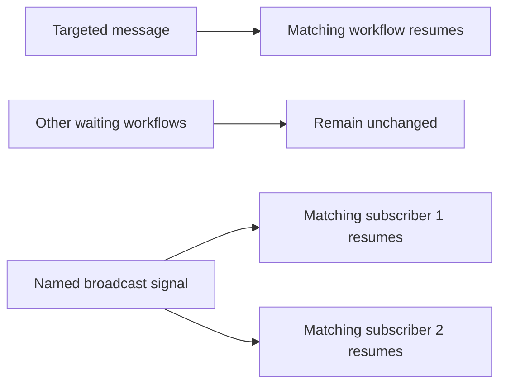

# FNV-06: resume the right workflows

A payment workflow may wait for an external status update. A message should reach its intended waiting process. A broadcast signal can deliberately reach several subscribers. A batch operation acts on a declared set of processes. This pattern checks those recipient sets and the resulting engine state before attempting a performance comparison.



The initial [local qualification](../validation/local-20261101-fnv06/README.md) passed **12 case families across 42 workflow instances** on the checksum-verified Fluxnova 3.0.1 distribution, Java 21 and a fresh embedded H2 database. A separate auditor checked fourteen operations, three completed asynchronous batches, thirteen expected event completions and twenty-nine workflows that remained waiting before cleanup. No unintended transition or duplicate end event was observed.

## What the cases cover

| Cases | Operation | Required outcome |
| --- | --- | --- |
| M01-M03 | Matching, unmatched and ambiguous message keys | Advance the one intended process, or reject without changing any process |
| M04 | Repeat an already consumed intermediate message | One completion; the repeat finds no eligible subscription |
| M05-M06 | Explicit tenant selection and intentional all-matches correlation | Exactly the declared recipient set |
| S01-S04 | Named broadcast, one execution, missing execution and tenant-filtered signal | Expected recipients advance; all other subscriptions stay intact |
| B01 | Asynchronous message batch | Exactly four listed members complete; two controls remain waiting |
| B02 | Asynchronous suspension, then reactivation | Exactly four members change state and return to active; two controls remain unchanged |

The [frozen corpus](../workloads/fnv06/cases.json) specifies every input, HTTP result and expected process state before execution. Four deliberately invalid operations return their expected errors. In this pinned release, a signal aimed at a missing execution returns HTTP 500; it must not fall back to broadcast. The [message implementation](https://github.com/finos/fluxnova-bpm-platform/blob/c465509aa71f76508274d9f464a2a90f83667525/engine-rest/engine-rest/src/main/java/org/finos/fluxnova/bpm/engine/rest/impl/MessageRestServiceImpl.java) and [signal implementation](https://github.com/finos/fluxnova-bpm-platform/blob/c465509aa71f76508274d9f464a2a90f83667525/engine-rest/engine-rest/src/main/java/org/finos/fluxnova/bpm/engine/rest/impl/SignalRestServiceImpl.java) anchor those API expectations.

Both [message](../workloads/fnv06/message.bpmn) and [signal](../workloads/fnv06/signal.bpmn) templates are start → intermediate catch → end. Each case receives distinct event names. Explicit tenant fixtures use identical business keys across two tenants and a no-tenant control. These check routing; they do not establish a complete tenant authorization boundary.

## Run and audit

Prepare the verified Fluxnova 3.0.1 ZIP and extracted distribution under `.tools`, plus Java 21. The runner checks loaded JARs against the distribution hash already used by the local workload runners. Choose fresh output directories for every attempt.

```powershell
python scripts/run_fnv06_functional.py --output dist/fnv06-local-NEW
python scripts/audit_fnv06_functional.py --source dist/fnv06-local-NEW --output dist/fnv06-local-NEW-audit
```

Use `--runtime` and `--java` for other local installation paths; the verified ZIP must still be available to the distribution checker. The runner binds to loopback, creates a new H2 database and temporary credentials, and stops only its owned engine. It requires no OCI credentials, model endpoint or payment service. Failed attempts are retained.

The collector records original inputs, actual deployed XML, every request/response and complete counted inventories of process history, active processes, activities, variables, subscriptions, jobs, incidents and batches. It waits for asynchronous batch completion and retains job logs. An HTTP success or batch-creation receipt alone cannot pass. Every snapshot also checks the controls from earlier cases, so later broadcasts cannot silently alter them.

The [auditor](../scripts/audit_fnv06_functional.py) reads the sealed evidence without calling the engine or importing the collector. It reconciles recipient identity, exact variables, completion count, suspension state, batch membership, job completion and cleanup. Its adversarial unit checks reject wrong recipients, hidden extra processes, duplicate completions, changed controls, mismatched query evidence and unfinished or duplicate batch jobs.

## Scope and next gate

This is functional evidence from a small synthetic local population. It does not measure burst handling, correlation p99, batch-size scaling, maximum capacity or OCI/PostgreSQL behavior. The repeat-message case concerns one consumed intermediate subscription; message-start events, concurrent duplicate races, broker delivery guarantees, recovery and general exactly-once effects are separate questions. There is no payment backend or live agent in this pattern.

Next: qualify the same cases on an isolated OCI/PostgreSQL cell with source preservation and cleanup controls. Then declare separate message fan-in, signal fan-out and batch-size experiments, including rates, populations, repeats, state resets, failure accounting, telemetry and a cost window. Keep all attempts and unfavorable results.
