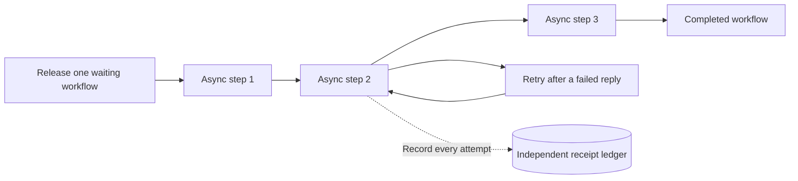

# FNV-07: distinguish attempts, effects and completed workflows

Adding engines lets several Fluxnova job executors work from the same database. Before measuring whether that helps, we need to know who executed each job, which attempts failed, what the external service actually changed, and whether the workflow committed its progress.

The first gate uses three asynchronous steps and a synthetic receipt service. There are no payment transfers or model calls.



## Six declared cases

| Case | What happens at step 2 | Required final state |
| --- | --- | --- |
| Normal | Commit an effect and return its receipt | All three steps complete; three effects |
| Fail before, once | Reject the first attempt before changing the backend | Retry succeeds; three effects |
| Fail after, once | Commit the effect, then deliberately return HTTP 503 | Retry gets the existing receipt; three effects |
| Fail before, always | All three allowed attempts fail before an effect | Workflow remains blocked after step 1; one effect |
| Fail after, always | Commit once, but return HTTP 503 on every allowed attempt | Workflow remains blocked after step 1; two effects |
| Waiting control | Never release the workflow | No work or effects |

The failed-after cases matter: an external effect can exist even though the engine has not committed that step. A completed HTTP request, a delegate success message, an external receipt and a completed workflow are separate observations.

The backend deliberately enforces a unique effect for each registered workflow step. This qualifies that specific idempotent integration. It does not establish a general exactly-once guarantee from Fluxnova or a network transport. HTTP 503 after a commit is an explicit synthetic fault; it is not a measured real-provider outage.

## Evidence and acceptance

The [case file](../workloads/fnv07/cases.json) declares the expected states before execution. The [BPMN model](../workloads/fnv07/cluster-jobs.bpmn) uses exclusive asynchronous jobs and explicit retry settings. The [Java delegate](../services/fnv07/RecordingDelegate.java) records a distinct invocation and the actual executor configuration for each engine. The [receipt service](../services/cluster_probe.py) binds effects to the original process, business key and input hash in a durable SQLite ledger.

The [collector](../benchlib/fnv07_functional.py) preserves original requests and counted inventories. The [independent auditor](../benchlib/fnv07_audit.py) reconciles those records with process history, variables, job creation/success/failure records, delegate logs and the original ledger. Expected totals for one six-case run are 19 delegate attempts, 8 failed attempts, 12 distinct effects, 3 completed workflows, 2 blocked workflows and 1 unchanged control. The blocked-after-effect case must remain blocked in the result.

The [single-engine local qualification](../validation/local-20261101-fnv07/README.md) passed on Fluxnova 3.0.1, Java 21 and fresh H2. H2 is used for this single-engine gate only. PostgreSQL qualification adds a [read-only SQL capture](../benchlib/fnv07_sql.py) and a separate [SQL/REST auditor](../benchlib/fnv07_sql_audit.py). This benchmark's clustering gate uses PostgreSQL and requires evidence that every declared node actually executed work. The [one- and two-engine OCI checks](../validation/oci-20261101-fnv07/README.md) passed; both engines executed jobs in the two-engine run. They shared one controller and a private PostgreSQL container, so these are functional results, not distributed scale-out measurements.

## Run the local gate

Prepare the verified Fluxnova 3.0.1 ZIP and extracted distribution under `.tools`. Use a Java 21 compiler and Java 21 runtime. Choose fresh directories for every build and run; retain failed attempts.

```text
python scripts/build_fnv07_delegate.py --runtime .tools/fluxnova-3.0.1 --javac PATH_TO_JAVAC --output dist/fnv07-build-NEW
python scripts/run_fnv07_functional.py --runtime .tools/fluxnova-3.0.1 --java PATH_TO_JAVA --build dist/fnv07-build-NEW --output dist/fnv07-local-NEW
python scripts/audit_fnv07_functional.py --source dist/fnv07-local-NEW --output dist/fnv07-local-NEW-audit
```

The runner binds to loopback, creates temporary credentials and a fresh database, captures its evidence, and stops its own engine and probe. A deliberately failed collection was also checked: its snapshots and logs survived cleanup and the auditor refused to accept it.

## What remains before the performance comparison

The [local fixed-arrival timing qualification](fnv07-timing.md) now verifies the normal-case driver and original-clock observations. All 20 scheduled workflows reconciled with 60 receipts and successful jobs. This is separate from the six fault cases and from the proposed 20 measured scaling cells.

The original FNV-07 question is a fixed-arrival comparison of 1, 2, 3 and 6 engine replicas. That measured campaign has not started. It still needs qualified multi-engine deployment and cleanup, declared host placement and resources, a separate offered-load pilot, verified generator/database headroom, and a frozen repeat matrix. Per-engine resources remain fixed while total engine resources increase. Fixed offered load alone cannot establish maximum capacity or linear scaling.

Node-loss recovery, managed-database behavior and production payment safety require their own evidence. They are not inferred from this functional corpus.
