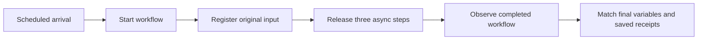

# FNV-07: measure from the scheduled request to the verified outcome

Before comparing engine counts, this gate checks that the benchmark can keep sending work at the declared rate and measure when that work is actually finished. It uses the same three-step asynchronous workflow as the [functional gate](fnv07-cluster-jobs.md), with normal outcomes only.



The clock starts at the scheduled arrival, including any dispatch delay. It stops after the last response needed to verify the original process, its final variables and all three receipts. It includes fixture registration and 100 ms completion polling. It does not use a delegate log timestamp or a receipt handler timestamp as proof of durable completion.

## Keep the original denominator

The driver follows an absolute schedule on one monotonic clock. Its worker count is fixed. If every worker is occupied, the arrival is recorded as missed; the driver does not slow the schedule or queue a later catch-up burst. Failed requests and unknown mutation outcomes remain in the record. Start, registration and release mutations are never automatically retried.

Each observation reads only one registered case and its three effects. Full attempt ledgers are collected at closeout, avoiding a growing full-ledger download on every poll. The receipt endpoint requires the administrative token; an execution token cannot read it.

The [saved-evidence auditor](../benchlib/fnv07_timing_audit.py) independently checks original request bodies, monotonic timestamps, every scheduled arrival, process history, final variables, job records, delegate attempts and the SQLite ledger. It rejects receipt-only success, wrong inputs, altered clocks, missing requests and hidden failures.

## Qualified scope

The [local result](../validation/local-20261101-fnv07-timing/README.md) passed with 20 scheduled workflows at 2 starts/s for 10 seconds. All 20 reached their expected outcome; 60 committed effects and 60 successful jobs reconciled. No arrivals or HTTP failures were discarded. The owned local engine and receipt service were stopped.

This is a small Fluxnova 3.0.1 / Java 21 / H2 timing qualification with no warmup. It establishes neither a latency benchmark nor resource headroom, PostgreSQL performance, capacity or scaling. Its 20 workflows are separate from the proposed 20 measured scaling cells. A later pilot must reconcile any retries under load; this narrow gate requires no retries.

## Reproduce the local gate

Prepare the verified runtime and delegate build using the [functional-gate instructions](fnv07-cluster-jobs.md#run-the-local-gate). Use a fresh output directory.

```text
python scripts/run_fnv07_functional.py --runtime .tools/fluxnova-3.0.1 --java PATH_TO_JAVA --build dist/fnv07-build-NEW --output dist/fnv07-timing-NEW --timing-qualification
python scripts/audit_fnv07_timing.py dist/fnv07-timing-NEW
```

The [qualification protocol](../workloads/fnv07/load-qualification.json) is deliberately bounded. The next gate must capture generator/observer, receipt-service, engine and database resources while real work runs on the selected cloud placement. After that, a separate offered-rate pilot can inform the frozen 1/2/3/6-engine, five-repeat study.

## Diagnose a rejected run

Never replace a failed qualification or relax its no-retry rule. Use a fresh output directory for every diagnostic arm. The existing runner accepts `--transport-diagnostics` to capture a sealed `transport.ndjson` alongside normal evidence. This opt-in tracing records connection lifecycle, allowlisted routes, byte counts, response status and exception types; it omits headers, payloads and exception messages. Synchronous trace writes add overhead, so these runs are not performance comparisons.

```text
python scripts/run_fnv07_functional.py --runtime PATH_TO_RUNTIME --java PATH_TO_JAVA --build PATH_TO_BUILD --output dist/fnv07-diagnostic-NEW --timing-qualification --transport-diagnostics
python scripts/diagnose_fnv07_transport.py dist/fnv07-diagnostic-NEW --output dist/diagnostics/report-NEW.json
```

The report verifies the saved checksum seal, counts delegate and durable receipt attempts separately, reruns the independent timing auditor and reports its rejection reason. A report can be successfully generated for a failed run; inspect `timing_qualification`, not the report command’s exit code. It refuses to overwrite a report or write inside original evidence. Historical evidence without a trace is supported. Checksums detect changes relative to the supplied seal, not the authenticity of an externally supplied experiment.

`--probe-connection-close` is a separate diagnostic arm, requiring tracing. It explicitly adds `Connection: close` to fixture responses and records that choice in the manifest. It tests a connection-lifecycle hypothesis; it is not a qualified fix or an accepted benchmark change. All workload, retry and timing acceptance rules stay unchanged.

A server `response_sent` event means its write returned, not that Java received the reply or that Fluxnova committed the job. Compare both sides and the receipt ledger before assigning a cause. Socket failures can occur before a request reaches the handler. Traces with recording errors or an incomplete seal are not complete diagnostic evidence.
