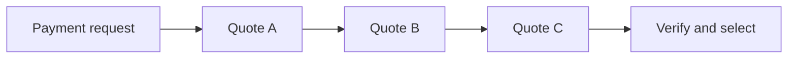
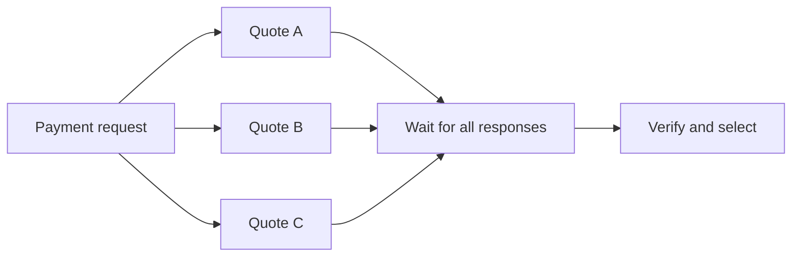

# PAY-05: choose an eligible FX quote

This pattern asks a practical question: can a workflow request three independent quotes together and still choose the correct authorized route? The baseline asks A, then B, then C. The treatment asks all three concurrently. Both wait for every response before using the same backend selection policy.





The executable models are [sequential BPMN](../workloads/pay05/sequential.bpmn) and [parallel BPMN](../workloads/pay05/parallel.bpmn). Both use three worker slots and the same [22-case corpus](../workloads/pay05/cases.json).

## What counts as correct

The payment specifies a fixed target amount and currency, a source currency, a beneficiary, an authorized route list and a maximum source debit. The backend chooses the eligible quote with the lowest **source amount plus source-currency fee**. Route ID breaks equal-cost ties. This avoids comparing rates while ignoring fees.

Quote validity uses the case's trusted registration clock: `issued_ms <= decision_ms < expires_ms`. A quote that expires exactly at the decision is ineligible. Wrong payment, beneficiary, currency or amount bindings are ineligible, as are unauthorized routes and malformed or non-integer monetary values. If the declared minimum number of eligible quotes is unavailable, the workflow stops without an effect. An unauthorized payment is rejected.

The trusted registrar binds immutable inputs to one process and business payment ID. Workers submit only the binding and operation; they cannot supply an approval, selected route or replacement amount. Selection and the synthetic ledger effect are recorded in one SQLite transaction. Repeating an operation returns its original receipt, even after quote expiry; it does not create another effect.

This is a synthetic fixture with trusted registration. Signed-intent integration, real FX providers, external payment networks and host/database failover are separate qualification gates.

## What has passed

The [local qualification](../validation/local-20261031-pay05/README.md) ran all 22 scenarios in both BPMN models on the published Fluxnova 3.0.1 distribution, Java 21 and an isolated H2 database. The independent audit verified 44 scenario executions, 34 expected synthetic effects, ten expected no-effect outcomes, 352 repeated calls without extra effects and two blocked cross-process replays. All owned services stopped and engine queues were empty.

The initial attempt failed its three-way overlap requirement even though its two payment outcomes were correct. A follow-up with preinitialized worker clients passed, but another repeat failed the same short probe. Client initialization alone did not establish repeatability; the underlying acquisition stagger has not been isolated.

Corpus revision 2 therefore declares a separate, longer concurrency probe: the `lowest_total_cost` case uses 1,000 ms per quote in **both** arms, with the same three-way overlap requirement. The other 21 cases and all expected payment outcomes are unchanged. A fresh local run and independent audit passed all 44 executions with this revision. Earlier 180 ms attempts remain separate. The longer probe establishes overlap capability; it is not representative FX latency and provides no speedup estimate.

## Run and audit locally

Use the repository's Python 3.12+ environment and a checksum-verified Fluxnova 3.0.1 distribution. The existing local runner verifies the loaded JARs against `.tools/fluxnova-3.0.1.zip`. Specify a Java 21 executable with `--java` when it differs from the Windows default. Choose new output directories for every attempt.

```powershell
python scripts/run_pay05_functional.py --output dist/pay05-local-001
python scripts/audit_pay05_functional.py --source dist/pay05-local-001 --output dist/pay05-local-001-audit
```

The runner binds only to loopback, creates a new H2 database and temporary local credentials, and shuts down the services it owns. The evidence includes original inputs, source hashes, workflow history, backend receipts, synthetic effects, replay probes and checksums. The auditor reads the sealed evidence and database without calling the quote selector or starting new workflows.

The [OCI qualification runner](../scripts/run_pay05_cloud.py) uses this same fixed-case collector in an isolated container, a separate engine and a fresh managed PostgreSQL database. It requires a prepared private stage, pinned images, verified TLS, explicit source/target identity, an expiry window and separate guarded database provisioning/deletion. It is not a general cloud installer or a performance campaign launcher.

## OCI functional qualification

The [OCI qualification](../validation/oci-20261031-pay05-qualification/README.md) passed all 44 revision-2 scenario executions on Fluxnova 3.0.1 and managed PostgreSQL 17.6, with 34 expected effects, 352 idempotent repeated operations and two blocked cross-process replays. The independent audit passed; the temporary database and runtime were removed. Reference workflow state was preserved, with a separately verified append of idle-engine metering rows.

## Offered-load qualification

The [offered-load runner](../scripts/run_pay05_load_cloud.py) uses k6 to offer the same revision-2 cases at 0.5 and 1 start per second in both models. Each of four qualification lanes has 22 warmup arrivals and 44 measured arrivals. Three worker slots, a 100 ms completion-observation interval and a two-second outcome deadline stay fixed. The longer overlap probe remains in this **qualification** population; it is not a representative performance sample.

Before each lane, the runner restores and fingerprints both the complete owned PostgreSQL workflow schema and the synthetic payment ledger. It retains the prior state, checks generator headroom, samples Linux/container/SQL telemetry and reconciles every offered arrival against process history, four bound operation receipts and the exact expected effect. Deadline misses remain visible results; invalid accounting, incorrect outcomes, missing telemetry or failed resets stop the qualification. The [independent audit](../scripts/audit_pay05_load.py) checks sealed evidence against saved SQLite ledgers and separately queried SQL history.

The [OCI load/reset qualification](../validation/oci-20261031-pay05-load-qualification/README.md) passed all four lanes: 264/264 correct outcomes, 204 expected effects, four verified state resets and complete declared telemetry/headroom checks. Seven deadline misses were retained, all from the long functional overlap probe. The independent audit passed and temporary resources were removed. The subsequent performance study declared its population, quote-delay profiles, rate, warmup, repeats, deadline, resource controls, reset rules, telemetry and cost window before comparison timing; its completed evidence is linked below. Keep all attempts and failures. Use separate strata when elapsed time changes quote eligibility; equal inputs do not guarantee equal eligible routes at different decision times.

No speedup, maximum capacity, live-agent advantage or real-market price result has been established by this functional qualification. A later live-agent versus rules comparison must use identical task inputs and authority controls.

## Declared delay-profile comparison

The [performance protocol](../workloads/pay05/performance-protocol.json) crosses all 22 policy/fault cases with three synthetic provider-delay profiles: 200/200/200 ms, 100/400/900 ms and 900/900/900 ms. These 66 cases provide equal coverage, not an estimate of customer traffic or real FX-provider latency. Payment authority, fees, expiry and expected outcomes stay unchanged. The functional overlap assertion is removed from this derived timing population; actual overlap remains an observation. The original functional corpus is retained.

Both models first qualify this exact trace at the prespecified 0.5 starts/s, with 66 warmup and 66 measured arrivals each. If both qualify, the [owned-stage runner](../scripts/run_pay05_performance_cloud.py) executes five sequential/parallel pairs, each arm containing 66 warmup and 396 measured arrivals. Pair order is counterbalanced three/two using a retained seed before any load. Each arm restores the complete workflow schema and payment ledger. Source, images, three worker slots, CPU/memory limits and 100 ms observation interval remain fixed.

The primary measure is the paired change in **correct settlements observed within two seconds per measured second**. Rejections and safe stops have their own denominators. Report all five paired changes, their median and range, plus p95/p99 by outcome and delay profile. Deadline misses remain results. Invalid accounting, incorrect effects, control drift, reset failures, missing worker evidence or resource/generator failures stop the attempt; an unfavorable arm is never replaced.

The [separate auditor](../scripts/audit_pay05_performance.py) checks the frozen design, every raw generator log, saved SQLite ledger, SQL process history, worker task inventory, checkpoint and telemetry record. The [completed OCI comparison](../validation/oci-20261031-pay05-comparison/README.md) passed all ten measurement arms and the final independent audit: 3,960/3,960 measured outcomes were correct; timely settlements rose from 668/1,530 sequentially to 1,530/1,530 in parallel. The median paired change was +0.2184 timely settlements/s. Parallel measured work also produced 910 cached backend replays, versus zero sequentially, without duplicate effects. A separate retained-log audit matched the retries to engine optimistic-lock failures from concurrent execution-state updates; those retry costs are included in the observed latency. All 1,106 measured deadline misses remain in the result. This establishes a benefit for the declared synthetic delay population; customer/provider inputs and live-agent comparisons remain separate. Provisioning remains an operator-owned OCI step with explicit temporary-resource ownership, a cost window and cleanup; the workload models and analysis code can be reused on another qualified deployment.
